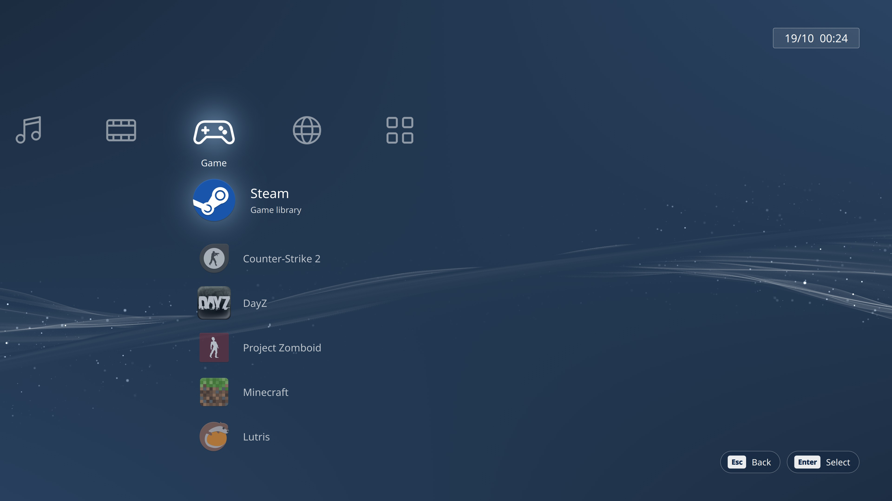

# XMB home screen for Plasma Bigscreen

A PlayStation 3 XMB-style home screen for [Plasma Bigscreen](https://plasma-bigscreen.org), KDE's TV interface for the sofa, a controller or a remote. Your apps, settings and power options sit in the PS3 "cross", over the live XMB wave.



A companion to [xmb-ps3-theme](https://github.com/luk3h/xmb-ps3-theme), the XMB login, lock and Shut Down screens for the normal Plasma desktop.

## Status

**Work in progress.** The menu works in a preview with made-up apps. It isn't hooked up to Bigscreen yet, so there's nothing to install.

Next up: your real apps, sorted into Game, Network, Video, Music, Photo and Apps, running inside Bigscreen itself.

## Try the preview

```bash
git clone https://github.com/luk3h/xmb-bigscreen.git
cd xmb-bigscreen
scripts/preview.sh
```

You need Qt's `qml` tool (Fedora: `sudo dnf install qt6-qtdeclarative-devel`), and Qt Multimedia for sound (`sudo dnf install qt6-qtmultimedia`). Nothing launches or changes in the preview.

| Key | Does |
|---|---|
| Left / Right | Change category |
| Up / Down | Move through the column |
| Enter | Select |
| Esc | Back to the top of the column |
| Ctrl+Q | Exit |

**Your own sounds:** put files named `move`, `select`, `back`, `error` and `open` in [`custom-sounds/`](custom-sounds/README.md) and the preview uses them straight away.

## Credits & licence

- Made by **luk3h**. Thanks to **Ronnavarium** on r/kde for the idea.
- **XMB wave shader:** originally by **int_45h**, updated by **llmciv**, both on Shadertoy. See [CREDITS.md](CREDITS.md).
- **Menu sounds and category icons:** original, made for this project. No Sony audio or artwork.
- Licensed under the **GNU GPL v3 or later** (see `LICENSE`). Plasma Bigscreen is by KDE (GPL-2.0-or-later).
- Inspired by the PlayStation 3 XMB. This is a fan project, **not affiliated with or endorsed by Sony Interactive Entertainment**. "PlayStation" and "PS3" are trademarks of their owners.
